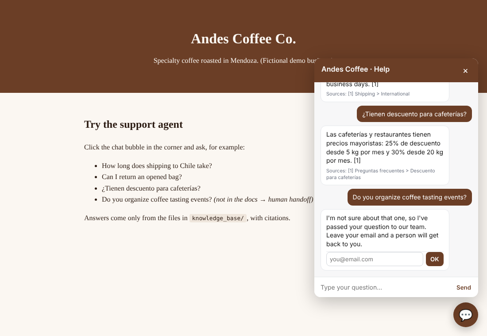

# AI Support Agent (RAG) — answers customers from your own documents

A drop-in customer-support chatbot for small businesses and SaaS products. It reads the company's own files (FAQs, policies, product sheets, PDFs, web pages), answers customers **only from those documents, with citations**, and **hands the conversation to a human** when the answer is not there. It goes on any website with **one `<script>` tag**.

> Demo business: *Andes Coffee Co.* (fictional). Try questions in English or Spanish.



## Why businesses want this

- Customers get instant answers 24/7; the team stops answering the same 20 questions.
- No hallucinated policies: if the documents don't say it, the bot says so and escalates.
- The owner sees a **knowledge-gap report**: the questions customers ask that the docs don't answer yet.

## Features

| | |
|---|---|
| **Grounded answers** | Retrieval-augmented generation: the model only sees the most relevant document sections and must cite them as `[1]`, `[2]`. |
| **Human handoff** | Low-confidence questions skip the LLM entirely; the customer can leave an email and the team is alerted through a webhook (Slack, n8n, Make, Google Chat, Discord). |
| **Any LLM provider** | Works with any OpenAI-compatible API: OpenAI, OpenRouter, Groq, Gemini, or a local model with Ollama. |
| **Free demo mode** | Without an API key it answers by quoting the best source, so a client can try it at zero cost. |
| **Bilingual** | Accent-insensitive search and replies in the customer's language (English/Spanish out of the box). |
| **Many formats** | `.md`, `.txt`, `.html` and `.pdf`, split by headings into citable sections. |
| **Embeddable widget** | Vanilla JS, Shadow DOM (never clashes with the site's CSS), mobile friendly, keeps the conversation during the visit. |
| **Admin API** | Usage stats, answer rate, knowledge gaps and re-indexing, protected by a token. |
| **Production basics** | Rate limiting, input limits, CORS allow-list, timeouts and fallbacks, SQLite logging, Dockerfile. |
| **Tested** | 26 pytest tests (retrieval, agent logic, API) and GitHub Actions CI. |

## How it works

```
question ─► BM25 retrieval over document sections ─► enough coverage? ── no ──► handoff + webhook + gap log
                                                          │ yes
                                                          ▼
                                   LLM with numbered sources and strict rules
                                                          │
                                       "NO_ANSWER"? ── yes ──► handoff
                                                          │ no
                                                          ▼
                                           answer + only the sources it cited
```

BM25 keyword search keeps hosting cheap and needs no vector database for knowledge bases of up to a few thousand pages; the retriever is a single class, so swapping in embeddings (pgvector, Pinecone, Qdrant) is a contained change.

## Quick start

```bash
python -m venv .venv
# Windows:  .venv\Scripts\activate      macOS/Linux:  source .venv/bin/activate
pip install -r requirements.txt
cp .env.example .env          # Windows: copy .env.example .env
python -m supportbot serve
```

Open http://localhost:8000 and click the chat bubble. To enable AI answers, put an API key in `.env`:

```
LLM_BASE_URL=https://api.openai.com/v1
LLM_API_KEY=sk-...
LLM_MODEL=gpt-4o-mini
```

Other useful commands:

```bash
python -m supportbot ask "Can I return an opened bag?"   # one question from the terminal
python -m supportbot index                               # see how the documents were split
pytest -q                                                # run the tests
```

## Use it for a real business

1. Replace the files in `knowledge_base/` with the client's documents.
2. Set `BUSINESS_NAME`, `ADMIN_TOKEN`, `ALLOWED_ORIGINS` and `HANDOFF_WEBHOOK_URL` in `.env`.
3. Deploy (Docker, Railway, Render, a VPS): `docker build -t supportbot . && docker run -p 8000:8000 --env-file .env supportbot`
4. Paste this into the client's website:

```html
<script src="https://YOUR-SERVER/widget.js"
        data-title="Help" data-color="#6B3E26"
        data-greeting="Hi! Ask me about orders, shipping or returns." defer></script>
```

## API

| Method | Path | Description |
|---|---|---|
| `POST` | `/api/chat` | `{"message", "conversation_id"?, "history"?}` → `{"answer", "sources", "handoff", "mode", "conversation_id"}` |
| `POST` | `/api/handoff` | `{"conversation_id", "email"}` attaches the customer's contact to the pending handoff |
| `GET` | `/api/admin/stats` | Questions, answer rate, handoffs, indexed chunks (`Authorization: Bearer <ADMIN_TOKEN>`) |
| `GET` | `/api/admin/gaps` | Most frequent unanswered questions |
| `POST` | `/api/admin/reindex` | Reload the documents without restarting |
| `GET` | `/widget.js`, `/`, `/health` | Widget, demo page, health check |

## Project structure

```
supportbot/
  ingest.py     # file loading and heading-aware chunking
  retriever.py  # BM25 search + coverage score
  llm.py        # OpenAI-compatible client and grounded prompt
  agent.py      # retrieval → answer → citations → handoff
  store.py      # SQLite: messages, handoffs, knowledge gaps, stats
  server.py     # Flask API, CORS, rate limiting, admin auth
  static/       # widget.js and the demo page
knowledge_base/ # sample documents of the demo business
tests/
```

## License

MIT
